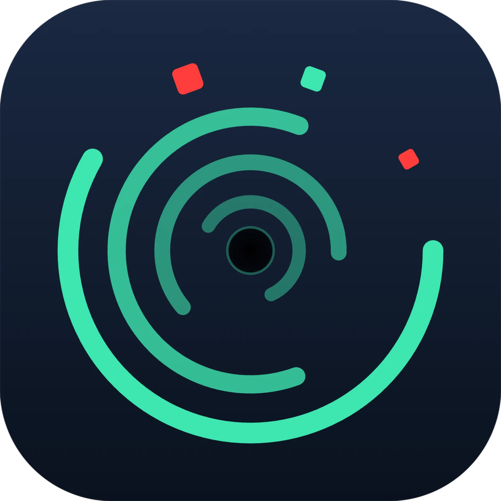

# NetSucker

A tiny macOS menu bar app that shows your network traffic — all the time, no clicking required.

<p align="left"></p>

## What it does

- **Live ↓/↑ meter in the menu bar title itself** — always visible, e.g. `↓6KB/s ↑3KB/s`. Reads the raw counters of whatever interface currently holds the default route (`netstat -ib` / `route get default`), the same technique standalone "Bandwidth+"-style meter apps use. No separate app needed.
- **Top bandwidth-hogging apps**, in a dropdown, refreshed every few seconds — built on `nettop` (built into macOS, no kernel extensions required).
- **NIC info submenu** — click the meter to see the active interface's hardware name (e.g. "Wi-Fi"), IP address, MAC address, and link status.

No kernel extensions, no $45.

## Install

Download `NetSucker.app` from the [Releases](../../releases) page, drag it into `/Applications`, and open it.

Since it isn't notarized/signed, the first launch needs a right-click → **Open** (or `xattr -dr com.apple.quarantine /Applications/NetSucker.app`) to get past Gatekeeper.

On first launch it'll ask whether to start automatically at login; you can change that later in **System Settings → General → Login Items**.

## Run from source

```bash
pip3 install rumps
python3 bandwidth_menubar.py
```

## Build the app yourself

```bash
python3 -m venv venv
./venv/bin/pip install rumps py2app
./venv/bin/python3 setup.py py2app
```

Produces a self-contained `dist/NetSucker.app` that bundles Python and all dependencies, so it runs without the venv or system Python.

## Notes

- `nettop` (used for the per-app list) only shows full detail for processes it can see without root. For everyday apps (Chrome, Slack, Dropbox, etc.) that's normally plenty. If entries look sparse, try running the underlying command with `sudo` in Terminal instead:
  ```bash
  sudo nettop -x -P -J bytes_in,bytes_out -l 1
  ```
- The menu bar meter itself doesn't use `nettop` at all, so it isn't affected by that limitation.
